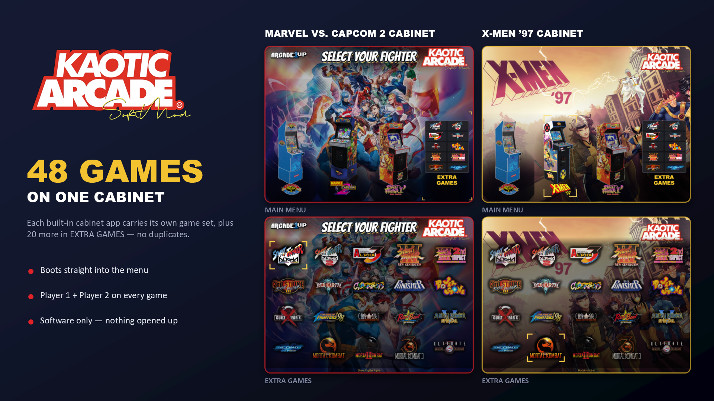

# Arcade1Up Marvel vs Capcom 2 cabinet expansion (Android, no root)

Turns the Arcade1Up **Marvel vs Capcom 2** cabinet (and the **X-Men '97** edition) into a multi-game machine:
a custom front-end menu with music, Big Blue (Street Fighter II Champion Edition) and Yoga Flame (Street Fighter II
Hyper Fighting) alongside the original game, and an **Extra Games** menu that runs 20 more arcade games through
RetroArch, **with two-player support**. The original MvC2 is not modified, and nothing needs root.



```
a1up-mvc2/
├── mod-v2-mvc2/     # installer for the MvC2 cabinet: INSTALL / UNINSTALL / VERIFY-ROMS (.bat) + mac/ (.command)
├── mod-v2-xmen97/   # the same installer for the X-Men '97 cabinet
├── 3in1/            # the smaller earlier mod: MvC2 + Big Blue + Yoga Flame only
├── crt-filter/      # optional CRT look (light / medium / heavy shaders) + strength switch
├── frontend/        # Java source of the front-end menu (extra games, controls screens, player-2 bridge, music)
├── tools/           # build helpers for the install card, screenshots and packages
├── docs/            # INSTALL_GUIDE.txt and REBUILDING.md (how the cabinet family works and how to mod others)
└── images/          # install card and screenshots
```

Each installer folder has its own `README.txt`, `INSTALL-GUIDE.txt` and `docs/` (how it works, control screens
per game, games list).

## What you must supply yourself
This repo holds **only the mod's own scripts, configs, docs and source**. The installers expect these files, which
are not included because they belong to others:

| File(s) | Where it goes | Where to get it |
|---|---|---|
| `BigBlue.apk`, `YogaFlame.apk` | `<installer>/apk/` | from Arcade1Up cabinets you own |
| `Frontend.apk` | `<installer>/apk/` | build it from `frontend/` (see `frontend/build-release.sh`) |
| `RetroArch_aarch64.apk` | `<installer>/apk/` | [retroarch.com](https://www.retroarch.com/?page=platforms) (Android, aarch64) |
| `fbneo_libretro_android.so`, `flycast_libretro_android.so` | `<installer>/cores/` | [libretro buildbot](https://buildbot.libretro.com/nightly/android/latest/arm64-v8a/) (see `cores/NOTICE.txt`) |
| `adb` (platform-tools) | `<installer>/platform-tools/` (and `mac/platform-tools/`) | [Android SDK Platform-Tools](https://developer.android.com/tools/releases/platform-tools) |
| Game ROMs | `<installer>/roms/` | your own legally obtained ROMs; `VERIFY-ROMS.bat` checks the names (see `docs/GAMES.txt`) |

## How the two-player trick works (short)
Only player 1 reaches Android's input system; player 2's controls never do. The cabinet's own panel device carries
both players, so the front-end runs a small service that reads it every 3 ms and forwards it to RetroArch's built-in
network gamepad. Details: `mod-v2-mvc2/docs/HOW-IT-WORKS.txt`.

## Status and disclaimer
Tested on the author's MvC2 cabinet. `docs/REBUILDING.md` covers other cabinets in the same 1Up family: those were
only analysed, not modded. This is an unofficial fan project, not affiliated with Arcade1Up, Capcom or Marvel.
Use it at your own risk; the uninstaller restores the stock setup.
