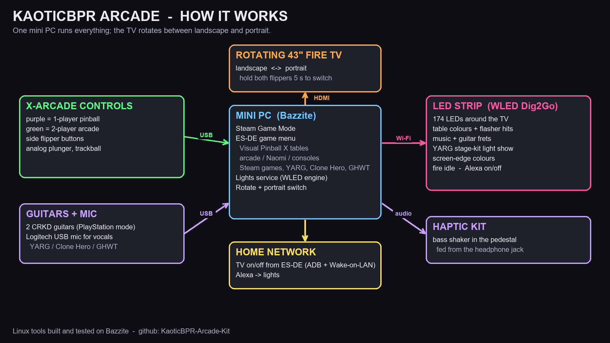

# X-Arcade setup (PC host + VPX): the rotating KaoticBPR arcade

A mini PC (Bazzite, Steam Game Mode, ES-DE) drives a 43" TV on a rotating mount: landscape for arcade and Steam
games, portrait for Visual Pinball X. Controls are an X-Arcade Arcade2TV-XR with side flipper buttons and an analog
plunger; a WLED LED strip around the TV reacts to every game.



```
xarcade-pc/
├── CLAUDE.md            # host facts + rules Claude Code follows here
├── machine.env.example  # copy to machine.env and fill in (git-ignored)
├── controls/            # measured X-Arcade maps (green + purple mode, plunger) and the VPX mapping
├── lights/              # WLED strip engine: table colours, flashers, music, rhythm games, screen colours, Fire TV control
├── scripts/             # landscape/portrait rotate switch (hold both flippers 5 s), Steam-menu guard, settings backup
├── vpx/                 # portrait layout generator + TABLES.md (table list with links, no table files)
├── hardware/led-clips/  # 3D-printable channels and gauges for mounting the strip on the TV edge (STL + generators)
├── docs/                # Linux fixes, haptic kit notes, how-it-works diagram
├── emulators/           # RetroArch / ES-DE settings
├── gamelists/           # curated gamelist.xml per system
└── backups/             # local snapshots (git-ignored)
```

## Who can use what
Everything here was built and tested on **Bazzite** only, with EmuDeck's `~/Emulation` layout, ES-DE and Steam
Game Mode. Read each script before running it and change the addresses, LED count and paths for your setup.

| Part | Bazzite | SteamOS | Windows | macOS |
|---|---|---|---|---|
| Lights engine, rotate/portrait scripts, backup | Yes (tested) | Untested, likely with small changes | No (needs PipeWire, evdev, systemd) | No |
| `lights/wled.py`, `lights/tv.py` (Python) | Yes | Yes | Should work, untested | Should work, untested |
| X-Arcade maps, VPX mapping notes | Yes | Yes | Yes | Yes |
| LED channel STL files | Yes | Yes | Yes | Yes |

Settings you must provide: the lights service takes `--wled-ip` and `--leds`
(`lights/govee-vpx.service.example`), `tv.py` reads `TV_IP` and `TV_MAC`, and `scripts/arcade-backup.sh` reads
`WLED_IP`. Nothing private (addresses, accounts, keys) is stored in this repo.

## What's not here
- **No tables, backglasses, ROMs or artwork.** They belong to their authors and ROMs are copyrighted;
  [`vpx/TABLES.md`](vpx/TABLES.md) links where to get each table. Please support the authors.
- **One-click installers** for Bazzite and Windows are still being finished and will be added later.

## Hardware
| Part | Used here |
|---|---|
| PC | Mini PC, AMD Ryzen 7 8745H / Radeon 780M, Bazzite |
| Screen | 43" Hisense Fire TV on a rotating mount (1080p 60 Hz) |
| Controls | X-Arcade Arcade2TV-XR (purple = 1-player pinball, green = 2-player), side flippers, analog plunger, trackball |
| Lights | QuinLED Dig2Go (WLED) with a 174-LED strip around the TV, in 3D-printed channels |
| Haptics | bass shaker in the pedestal, fed from the PC's headphone jack ([docs/HAPTICS.md](docs/HAPTICS.md)) |
| Rhythm games | two CRKD guitars (PlayStation mode on Linux), USB mic; YARG, Clone Hero, Guitar Hero World Tour |

Open Claude Code in this folder and see `CLAUDE.md` for the working rules.
