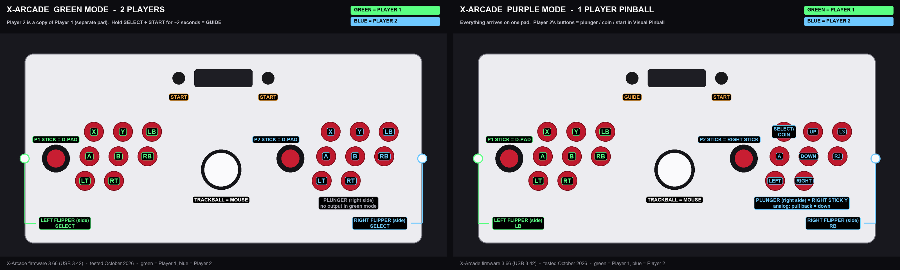

# Controls: X-Arcade Arcade2TV-XR

Measured on Linux (Bazzite) with firmware 3.66 (USB version 3.42), one control at a time. The X-Arcade shows up
as two "Microsoft X-Box 360 pad" controllers plus a trackball (mouse). Each side has 8 buttons in rows of 3 / 3 / 2,
a Start button at the top, and a flipper button on the outer side wall. A wired analog plunger sits under the right side.

## Green mode: 2 players
Two separate controllers; player 2 is an exact copy of player 1.

| Control | Output |
|---|---|
| Stick | D-pad |
| Top row (left to right) | X, Y, LB |
| Middle row | A, B, RB |
| Bottom row | LT, RT |
| 1P / 2P button | Start (for that player) |
| Side flipper button | Select (for that player) |
| Hold Select + Start ~2 s | Guide |
| Plunger | no output |

Photo version: [images/xarcade-green-mode.png](images/xarcade-green-mode.png)

## Purple mode: 1-player pinball
Everything arrives on the **first** controller; player 2's controls are folded into it.

| Control | Output |
|---|---|
| P1 stick | D-pad |
| P1 top / middle / bottom row | X, Y, LB / A, B, RB / LT, RT |
| 1P button | Guide |
| Left flipper (side) | LB |
| P2 stick | Right stick (on/off, full deflection) |
| P2 top row | Select (coin), D-pad Up, L3 |
| P2 middle row | A, D-pad Down, R3 |
| P2 bottom row | D-pad Left, D-pad Right |
| 2P button | Start |
| Right flipper (side) | RB |
| Plunger | Right stick Y, **analog** (0 at rest to full when pulled back) |
| Trackball | Mouse |

Photo version: [images/xarcade-purple-mode.png](images/xarcade-purple-mode.png)

## Visual Pinball X mapping used (purple mode)
VPX on Linux numbers the pad's buttons 0 A, 1 B, 2 X, 3 Y, 4 LB, 5 RB, 6 Select, 7 Start, 8 Guide, 9 L3, 10 R3 and
its axes 512 + n (0 left X, 1 left Y, 2 LT, 3 right X, 4 right Y, 5 RT).

| VPX action | Button |
|---|---|
| Left / right flipper | LB / RB (the side flipper buttons) |
| Coin | Select |
| Start | Start |
| Launch ball (tables without a plunger) | R3 |
| Magna-save left / right | X / L3 |
| Exit table | Select + Start |
| Plunger | axis 516 (right stick Y), position 0..1 |
| Nudge | left stick axes 512 / 513 (dead zone 0.05) |

`scripts/` does not write this for you on other machines; copy the `Mapping.*` lines into your `VPinballX.ini` `[Input]`
section, with your own device id.

## Firmware updates change the device id
The controller id VPX stores (`SDLJoy_030081b85e0400008e020000XXXX0000_1`) contains the X-Arcade's firmware version.
After updating to 3.66 it changed from `...40030000` to `...42030000`, so VPX treated the X-Arcade as two new
controllers and no button worked until the id in `VPinballX.ini` was updated. After any firmware update, check the
`VPX UID` lines in `vpinball.log` and replace the old id in `VPinballX.ini` (with VPX closed).
