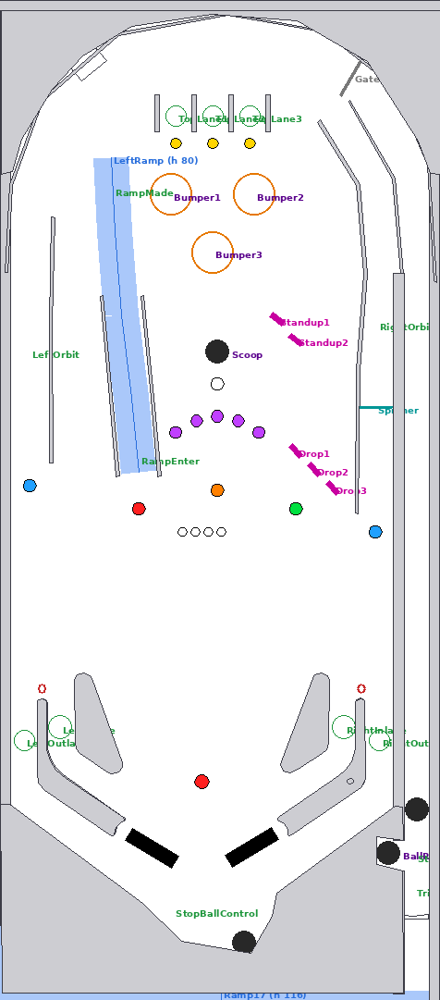

# Thursday Show: table design

Working title until the show's name and segments are in. Every name and line of text the player sees is
set in `script/00_setup.vbs`, so re-theming is one edit there.

## Shot map (v0.1)

| Shot | Fed by | Feature |
|---|---|---|
| Left ramp | right flipper | Segment 1, multiball jackpot, 5 per ball lights the extra ball |
| Left orbit / right orbit | right / left flipper | Orbit loops round the top arch. Segment 2. The spinner sits in the right lane (segment 5) |
| Center scoop | both flippers | Starts segments and multiball locks, collects the extra ball, starts the finale |
| Right 3-bank drop targets | left flipper | Completing the bank lights a lock. Segment 4 |
| 2 standups (under the right pop bumper) | left flipper | Both: +10 s on a running segment, else 15,000 |
| 3 pop bumpers | top lanes, ramp drop-off | Segment 3 |
| 3 top lanes | plunger, bumpers | Skill shot, bonus multiplier up to 5x, relight segment start |
| Inlanes / outlanes | | Bonus, outlane consolation |

## Rules (v0.1)

- **Free play, 1 to 4 players, 3 balls.** Press start during ball 1 to add players.
- **Skill shot:** while the ball is in the shooter lane, flippers move the blinking top lane. Plunge into
  it for 50,000.
- **Ball save:** 10 s, starting from the first switch after the plunge (15 s in multiball).
- **Segments (modes):** the scoop starts the lit segment. Each one runs 40 s and has one hot shot:
  1 ramps (5), 2 orbits (5), 3 bumpers (25), 4 drop targets (6), 5 spinner (60 spins). Finishing one
  scores 100,000. The first segment is lit at the start of every ball; completing the top lanes relights it.
- **Multiball:** each drop-target bank completion lights a lock at the scoop (virtual locks, so nothing
  gets stuck). The third lock starts 3-ball multiball; every ramp is a jackpot, starting at 100,000 and
  growing 25,000 per hit.
- **Season finale (wizard mode):** finish all five segments, then shoot the lit scoop. 3-ball multiball
  where the ramp and orbits score 100,000. When it ends, the segments reset.
- **Tilt:** nudging adds up; three warnings tilt the ball (no bonus, bumpers and slings go dead).
- **Bonus:** inlanes, ramps, orbits and segments build bonus, multiplied by the top-lane multiplier.

## Waiting on the show

These are the hooks that turn this into *your* table. Placeholders now, real names next:

| Hook | Where | Placeholder |
|---|---|---|
| Show name and tagline | `script/00_setup.vbs` `ShowName`, `ShowTagline` | THURSDAY SHOW / EVERY THURSDAY |
| The five segments | `SegmentNames` | SEGMENT ONE ... FIVE |
| Wizard mode | `WizardName` | SEASON FINALE |
| Multiball name | `MultiballName` | MULTIBALL |
| Which shot each segment uses | `ModeGoals`, `ModeValues` in `script/20_rules.vbs` | see above |
| Callouts and music | sound pack (below) | silent |
| Art | `art/` (see `art/README.md`) | plain playfield |

## Sound pack

The script already calls these sounds by name; until they exist the table is silent. Drop matching files
in and they will be added to the build:

| Name | When |
|---|---|
| `fx_flipperup`, `fx_flipperdown`, `flip_hit_1..3` | flippers |
| `plungerpull`, `plunger`, `ballrelease`, `drain` | ball handling |
| `fx_bumper`, `left_slingshot`, `right_slingshot` | bumpers and slings |
| `fx_droptarget`, `fx_resetdrop`, `fx_target`, `fx_spinner`, `fx_rampenter` | shots |
| `fx_kicker_enter`, `fx_kicker` | scoop |
| `fx_start`, `fx_skillshot`, `fx_jackpot`, `fx_extraball`, `fx_lock`, `fx_multiball` | callouts |
| `fx_modestart`, `fx_modecomplete`, `fx_warning`, `fx_tilt` | callouts |

Show clips (intro music, catchphrases) make the best callouts. Only use audio you own or that is free
to share, because the table will be published.

## Roadmap

1. **v0.1 (this):** layout, full rules, FlexDMD display, builds to a `.vpx`. Play-test on the 4KP.
2. **v0.2:** show theme: names, segment rules matched to the real show segments, callouts.
3. **v0.3:** art: playfield, plastics, backglass (`.directb2s`), launcher image. Ramp and plastics models.
4. **v0.4:** polish: lighting shows, GI effects, DMD animations, POV tuned on the 4KP, performance pass.
5. **v1.0:** publish (VPUniverse or a GitHub release), list it on VPS, PR the config to Legends Unchained.
