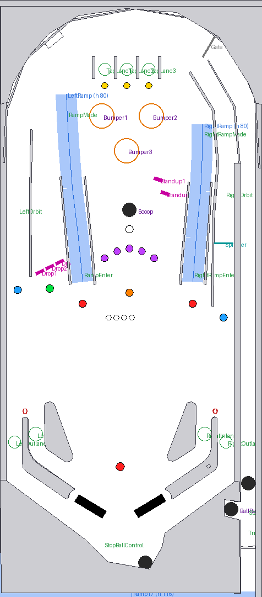

# Yo! Retro: table design

The show: Yo! Retro on [youtube.com/@kaoticbpr](https://www.youtube.com/@kaoticbpr).
KaoticBPR and his co-host Half-A-Dozen review AtGames table releases. Every name and line of text the
player sees is set in `script/00_setup.vbs`, so renaming is one edit.

## Shot map

| Shot | Fed by | Feature |
|---|---|---|
| Left ramp | right flipper | UNBOXING, multiball jackpots, 5 ramps per ball lights the extra ball. Drops off into the pop bumpers |
| Right ramp | left flipper | The left ramp's twin: same awards. Drops off above the right orbit. Left then right (or back) within 4 s is a COMBO, 50,000 |
| Left orbit / right orbit | right / left flipper | Loops round the top arch. FIRST FLIPS. The spinner sits in the right lane (THE VERDICT) |
| Center scoop | both flippers | Starts segments and multiball locks, collects the extra ball, starts Yo! Retro Live |
| Left 3-bank drop targets (pocket left of the left ramp) | right flipper | Completing the bank lights a lock. BUG HUNT |
| 2 standups (right of the scoop) | left flipper | Both: +10 s on a running segment, else 15,000 |
| 3 pop bumpers | top lanes, left ramp drop-off | CHAT ATTACK |
| 3 top lanes | plunger, bumpers | Skill shot, bonus multiplier up to 5x, relight segment start |
| Inlanes / outlanes | | Bonus, outlane consolation |

## Rules

- **Free play, 1 to 4 players, 3 balls.** Press start during ball 1 to add players.
- **Yo! Skill shot:** while the ball waits in the shooter lane, the flippers move the blinking top lane.
  Plunge into it for 50,000.
- **Ball save:** 10 s, starting from the first switch after the plunge (15 s in multiball).
- **Segments (an episode's run of show):** the scoop starts the lit segment. Each one runs 40 s and has
  one hot shot; finishing one scores 100,000. The next segment is lit at the start of every ball, and
  completing the top lanes relights it. Hitting both standups adds 10 s.

  | # | Segment | Hot shot | Goal |
  |---|---|---|---|
  | 1 | UNBOXING | either ramp | 5 |
  | 2 | FIRST FLIPS | orbits | 5 |
  | 3 | CHAT ATTACK | pop bumpers | 25 |
  | 4 | BUG HUNT | drop targets | 6 |
  | 5 | THE VERDICT | spinner | 60 spins |

  These are placeholders built around a review episode; rename them to the show's real segments.
- **Half-A-Dozen Multiball:** each drop-target bank completion lights a lock at the scoop (virtual
  locks, so nothing gets stuck). The third lock starts 3-ball multiball. Every ramp, left or right, is a jackpot
  (100,000, plus 25,000 a hit), and **every 6th jackpot is a "HALF-A-DOZEN!" super jackpot worth 6x**.
- **Yo! Retro Live (wizard mode):** finish all five segments, then shoot the lit scoop. 3-ball multiball
  where the ramp and orbits score 100,000. When it ends, the segments reset.
- **Tilt:** nudging adds up; three warnings tilt the ball (no bonus, bumpers and slings go dead).
- **Bonus:** inlanes, ramps, orbits and segments build bonus, multiplied by the top-lane multiplier.
- **Light shows:** between games the inserts run an attract show (a sweep up the table, blink-all,
  sparkle). Combos, jackpots, segment completes and multiball flash the whole table.
- **Voices and music:** KaoticBPR and Half-A-Dozen call out the action (see
  [VOICE_SCRIPT.md](VOICE_SCRIPT.md)), and the Yo! Retro theme loops under play. The attract mode
  credits both hosts and drops a host quip about every 36 s.

## Still to come from the show

| What | Where it goes |
|---|---|
| The real segment names (if the show has its own) | `SegmentNames`, `SegmentHints` in `script/00_setup.vbs` |
| Voice takes, recorded or clipped from episodes | `sounds/voice/`, see [VOICE_SCRIPT.md](VOICE_SCRIPT.md) |
| Plastics, a `.directb2s` backglass | `art/`, see [art/README.md](art/README.md) |

## Sound effects

`tools/make_sounds.py` synthesizes all of these into `sounds/` (mechanical sounds, plus 8-bit chiptune
stingers under the voice), so there's nothing to license. To replace one, drop a file with the same name
in `sounds/` and rebuild. Host callouts are separate (`sounds/voice/`).

| Name | When |
|---|---|
| `fx_flipperup`, `fx_flipperdown`, `flip_hit_1..3` | flippers |
| `plungerpull`, `plunger`, `ballrelease`, `drain` | ball handling |
| `fx_bumper`, `left_slingshot`, `right_slingshot` | bumpers and slings |
| `fx_droptarget`, `fx_resetdrop`, `fx_target`, `fx_spinner`, `fx_rampenter` | shots |
| `fx_kicker_enter`, `fx_kicker` | scoop |
| `fx_start`, `fx_skillshot`, `fx_jackpot`, `fx_extraball`, `fx_lock`, `fx_multiball` | stingers under the voice |
| `fx_modestart`, `fx_modecomplete`, `fx_warning`, `fx_tilt` | stingers under the voice |

Only use audio you own or that is free to share, because the table will be published.

## Roadmap

1. **v0.1:** layout, full rules, FlexDMD display, builds to a `.vpx`. Play-test on the 4KP.
2. **v0.2 (this):** Yo! Retro theme, segments, Half-A-Dozen Multiball, voice and music hooks.
   Theme song in. Next: voice takes, real segment names.
3. **v0.3:** art: cartoon hosts, playfield, plastics, backglass (`.directb2s`), launcher image.
4. **v0.4:** polish: lighting shows, GI effects, DMD animations of the hosts, POV tuned on the 4KP,
   performance pass.
5. **v1.0:** publish (VPUniverse or a GitHub release), list it on VPS, PR the config to Legends Unchained.
